# NotePad 记事本

学号029

## 一、基本功能

### 1. 笔记列表、编辑与时间戳

**功能说明**

- 点击首页右下角“+”新建笔记，标题和正文分别输入；新建标题默认为空，不会自动添加系统尖括号标题。
- 点击笔记卡片进入编辑页面，可保存修改或确认删除；离开编辑页面时会保存已有更改，完全空白的新笔记不会残留。
- 列表卡片显示加粗标题、最多两行的正文摘要和完整修改时间。未填写标题时，使用正文首行作为显示标题；标题和正文均为空时显示“无标题”。
- 时间格式为 `yyyy-MM-dd HH:mm:ss`，统一按中国标准时间（`Asia/Shanghai`）显示。
- 普通笔记按修改时间倒序排列；置顶笔记优先显示。

  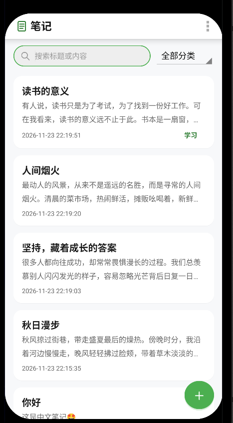
  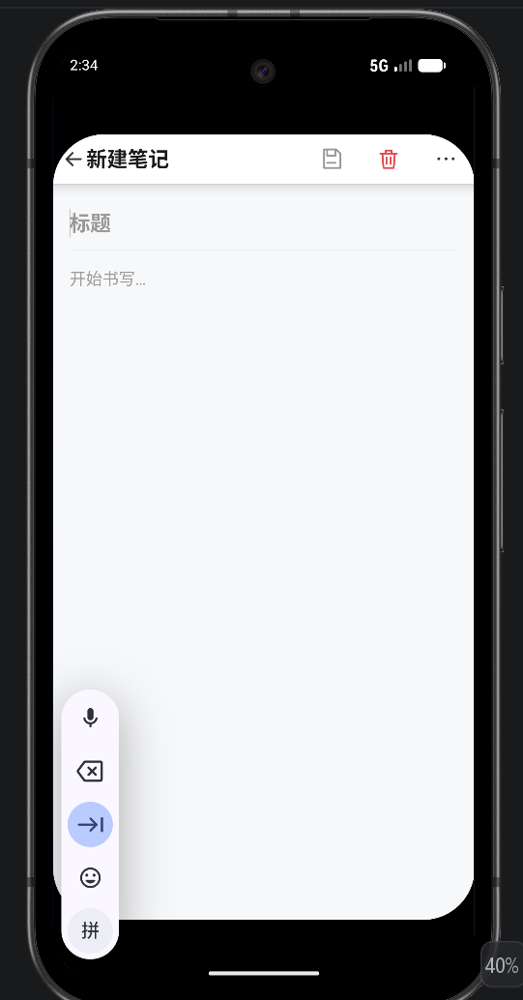

笔记列表与时间戳　｜　新建笔记与独立标题输入

### 2. 笔记内容搜索

**功能说明**

- 在首页搜索框输入关键词，可实时检索笔记标题和正文。
- 使用包含匹配实现模糊搜索；输入完整标题或完整内容片段时，也可以准确找到目标笔记。
- 点击搜索框右侧清除按钮可恢复完整列表；没有结果时显示“未找到相关笔记”及提示信息。
- 搜索条件可以与分类筛选叠加使用，缩小查找范围。

  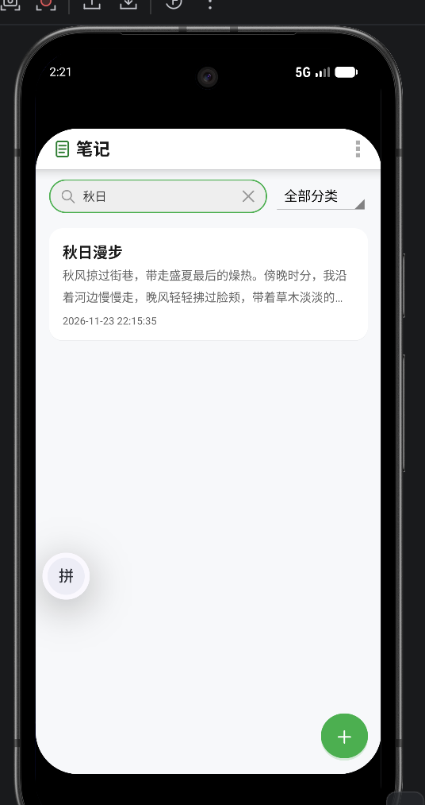

输入“秋日”后，仅显示匹配的笔记

## 二、拓展功能

### 1. 笔记分类与首页筛选

**功能说明**

- 在编辑页面点击右上角“更多”→“笔记分类”，可设置为：**未分类、工作、生活、学习、其他**。
- 已分类笔记会在列表卡片右下角显示分类名称。
- 首页分类下拉框可按分类筛选笔记，选择“全部分类”恢复显示全部内容。
- 分类筛选与关键词搜索可以同时生效。

  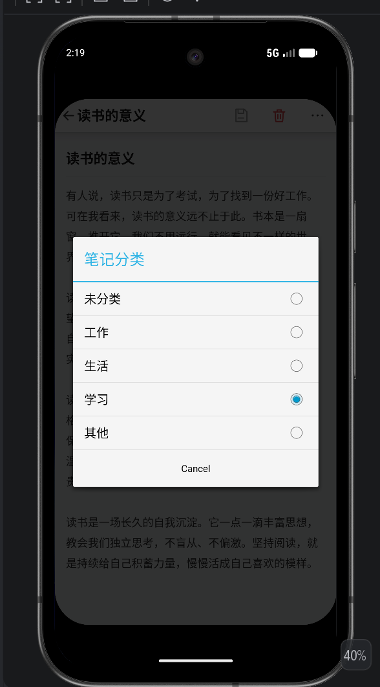
  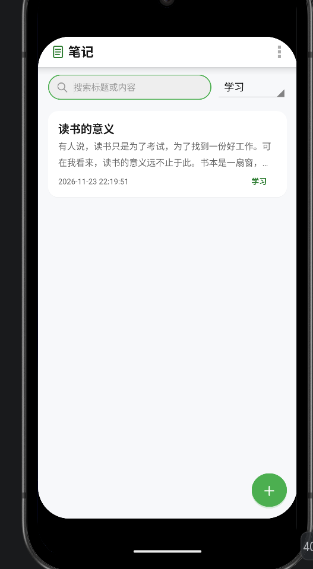

编辑器选择分类　｜　首页按“学习”分类筛选

### 2. 待办设置与完成状态

**功能说明**

- 在编辑页面点击“更多”→“设为待办”，普通笔记即转换为待办事项。
- 待办笔记在列表右侧显示圆形复选框，点击即可切换完成或未完成状态。
- 完成待办后，标题显示删除线并出现绿色勾选图标；取消待办会同时清除完成状态。
- 设置状态后，编辑器底部提供提示和“撤销”操作。

  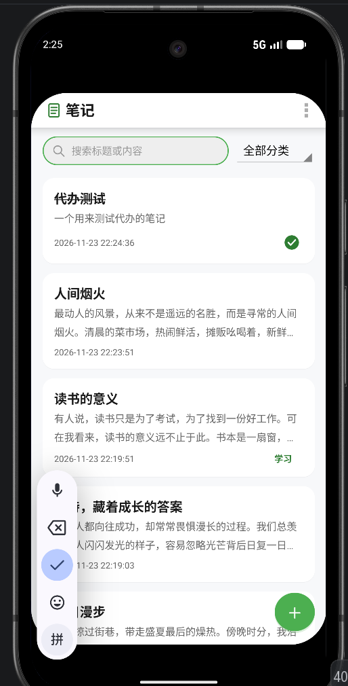

“代办测试”已完成，显示绿色勾选图标和标题删除线

### 3. 笔记置顶

**功能说明**

- 在编辑页面点击“更多”→“置顶笔记”，可将重要笔记固定在列表前部。
- 置顶笔记卡片标题右侧显示图钉图标；再次操作可取消置顶，并支持从底部提示中撤销。
- 置顶或取消置顶只改变展示顺序，不修改笔记正文，也不会刷新笔记的修改时间。

  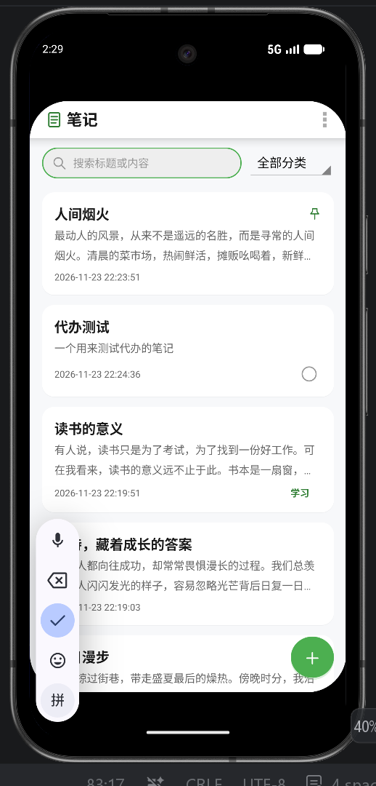

“人间烟火”已置顶，标题右侧显示图钉图标

### 4. 统一操作入口与笔记分享

**功能说明**

- 编辑器右上角“更多”打开底部操作面板，集中提供置顶、分享、分类、待办和恢复更改等入口。
- 点击“分享笔记”可调用系统分享面板，将标题和正文发送到其他支持文本分享的应用。
- 未发生编辑时隐藏“恢复更改”；没有可处理分享的应用时显示明确提示。

  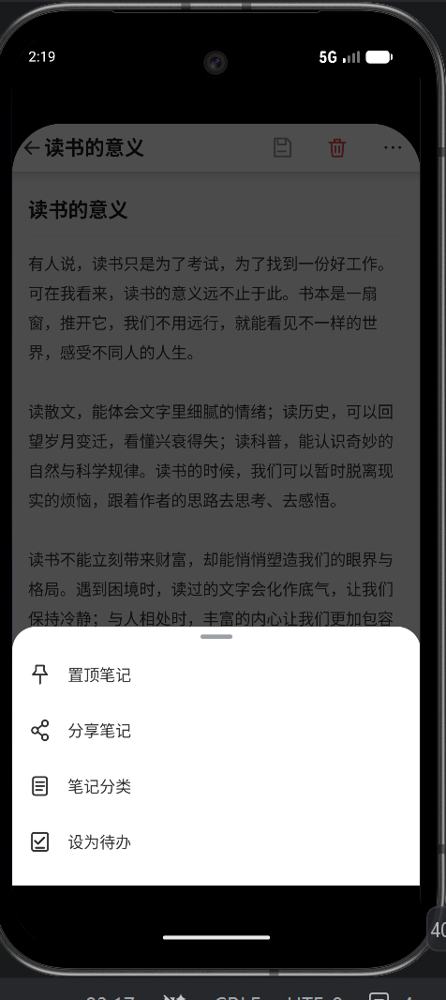

底部操作面板：置顶、分享、分类和待办

### 5. UI 美化与浅色、深色主题

**功能说明**

- 首页采用圆角卡片、留白分区和绿色品牌色，统一展示标题、摘要、时间、分类、待办及置顶状态。
- 搜索框、浮动新建按钮、线性图标、空状态提示和底部操作面板形成一致的视觉风格。
- 点击首页右上角菜单，可在“深色主题”和“浅色主题”之间切换；选择结果会保留，下次启动仍然生效。

  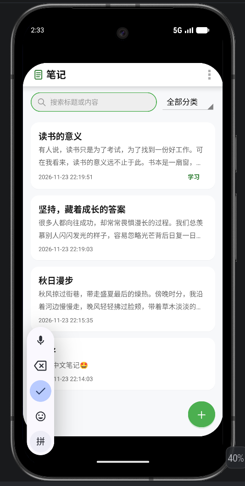
  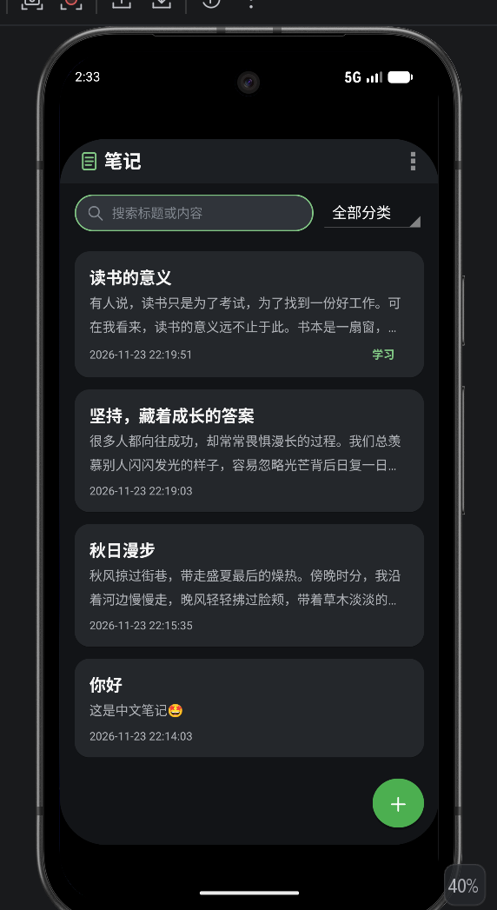

浅色主题　｜　深色主题

### 6. 中文与表情输入

**功能说明**

- 标题和正文均支持中文输入、中文拼音组词及系统输入法提供的 Emoji 表情。
- 标题采用单行输入，正文支持多行输入和垂直滚动，中文与表情可以混合保存和显示。

  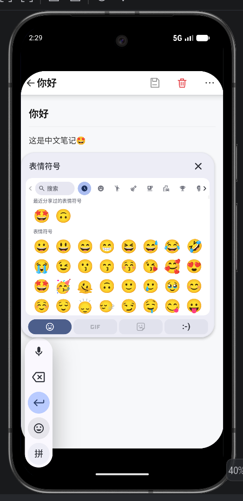

通过系统输入法输入中文和 Emoji

### 7. 读取剪贴板，一键粘贴为笔记

**功能说明**

- 复制文本后，打开首页右上角菜单并点击“粘贴”，即可新建包含剪贴板内容的笔记。
- 剪贴板为空时“粘贴”菜单不可用；粘贴后仍可继续编辑标题和正文。
- 除普通文本外，也支持从应用内笔记 URI 读取原标题和正文。

  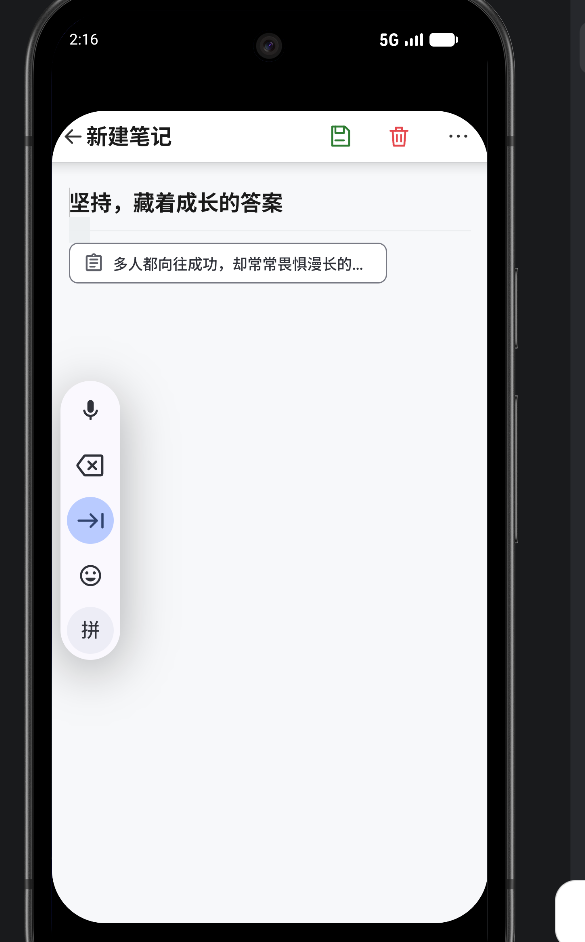

将已复制内容一键粘贴到笔记编辑器

